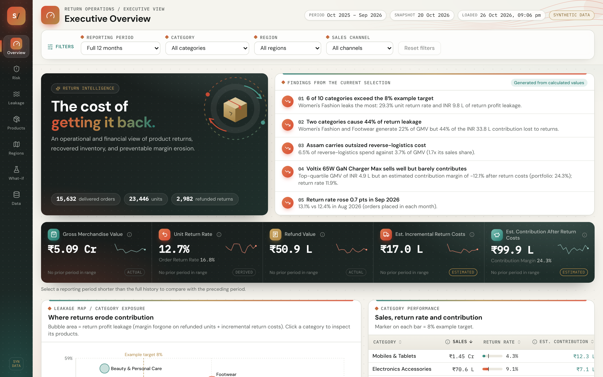
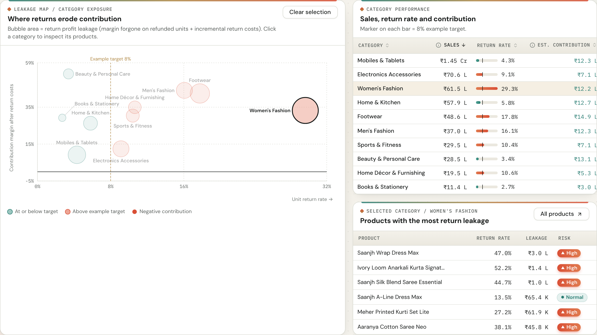
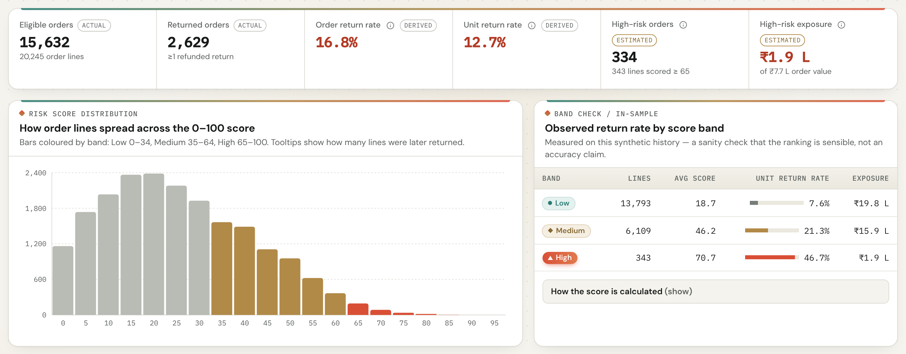
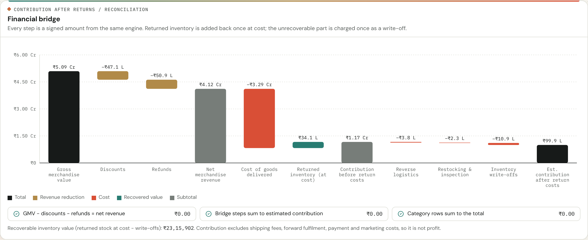
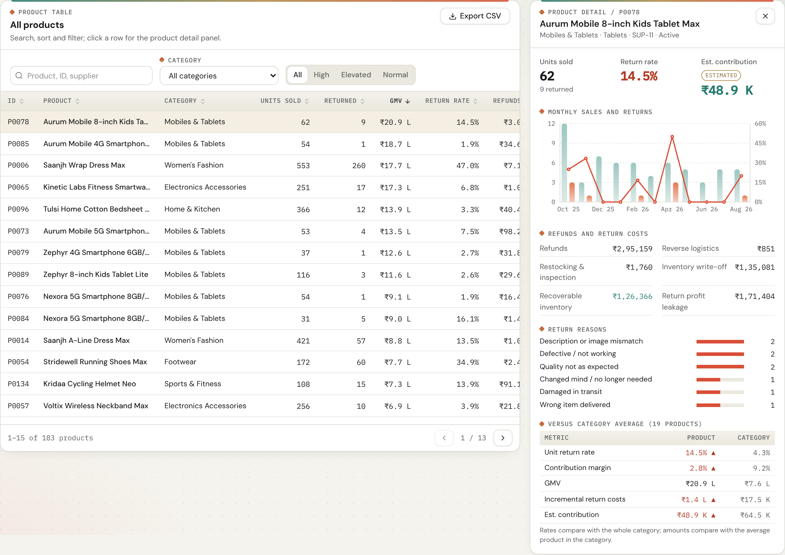
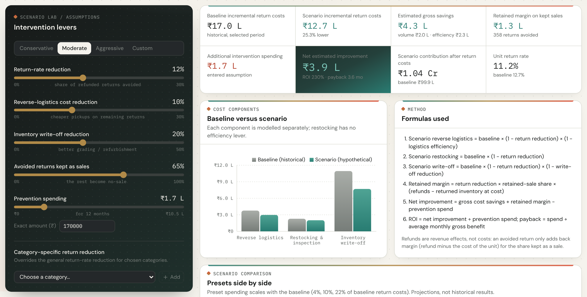
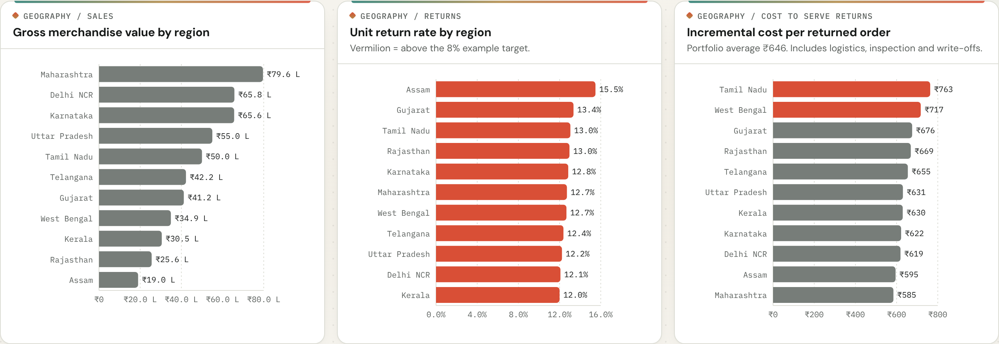
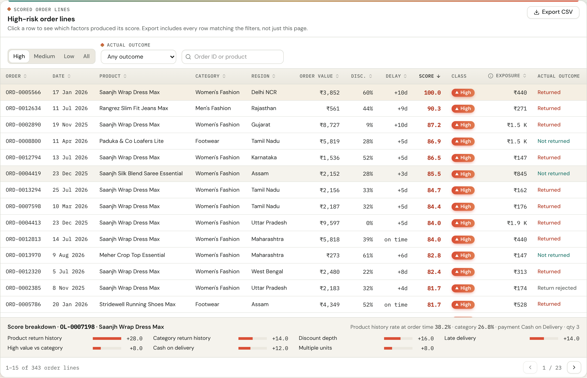
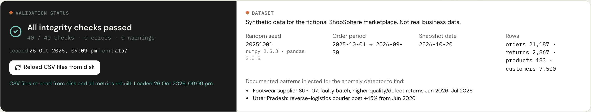
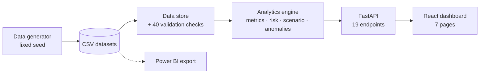

<div align="center">

# ReturnLens

### E-commerce return risk & profit leakage analytics

**A full-stack business intelligence app that measures how much profit an e-commerce company loses to product returns, where the loss comes from, and what fixing it would be worth.**


[](https://github.com/aninditamondal303/ReturnLens/actions/workflows/ci.yml)




</div>

## The problem

Most online stores report the cost of returns as "total refunds". That number is wrong in both directions: it ignores the courier, inspection and write-off costs that a return creates, and it ignores the stock that comes back and is sold again. This project builds one consistent financial model of returns and puts it in an interactive dashboard, so that finance, operations and category teams can see the real cost and decide where to act.

The demo company, ShopSphere, is fictional. All of its data is synthetic and generated by the project's own script, using Indian states, INR pricing and festive-season demand.

## Highlights

- **Reconciled profit model.** Refunds, cost of goods, recovered inventory and incremental return costs are each counted exactly once. A financial bridge runs from GMV to contribution and reconciles to ₹0.00 on every page and filter.
- **Leakage Map.** A bubble chart comparing categories by return rate, contribution margin and the profit they lose to returns. Click a bubble to drill into its products, then down to individual orders.
- **Explainable return-risk score (0–100).** A rule-based score built only from information available before a return happens, with point-in-time history and explicit data-leakage controls. Every score can be broken down factor by factor.
- **Anomaly detection.** Monthly flags for unusual return rates, courier costs and refund rates by category, region and supplier, each with a plain-language reason.
- **What-if simulator.** Sliders and presets estimate the net effect of fewer returns, cheaper pickups and less write-off, without double-counting savings.
- **Data quality lab.** 40 automated integrity checks, column profiles, foreign-key checks and CSV downloads.
- **Seven interactive pages** with shared filters, search, sorting, pagination and CSV export.

## Screenshots

| Leakage Map | Return risk |
|---|---|
|  |  |

| Financial bridge | Product intelligence |
|---|---|
|  |  |

| What-if simulator | Customer & geography |
|---|---|
|  |  |

| Scored orders | Data quality |
|---|---|
|  |  |

## Results on the generated dataset

| | |
|---|---|
| Order lines analysed | 21,187 (16,381 orders, 183 products, 10 categories, 11 states) |
| Gross merchandise value | ₹5.09 crore |
| Unit / order return rate | 12.7% / 16.8% |
| Refunds vs. true incremental return costs | ₹50.9 lakh vs. ₹17.0 lakh |
| Profit actually lost to returns | ₹33.8 lakh. Two categories cause 44% of it from 22% of sales |
| Observed return rate by risk band | Low 7.6% · Medium 21.3% · High 46.7% |

These figures describe synthetic data and are illustrative only.

## Tech stack

| Layer | Tools |
|---|---|
| Analytics engine | Python, pandas, NumPy |
| API | FastAPI, Pydantic, Uvicorn |
| Frontend | React 18, TypeScript, Vite, Tailwind CSS, Recharts, Lucide icons |
| Testing | pytest, FastAPI TestClient, Vitest |
| CI | GitHub Actions |
| BI export | Star-schema CSVs for Power BI (`scripts/export_powerbi.py`) |

## Architecture



Every number on screen comes from one central analytics engine, so no two pages can disagree.

## Run it locally

**Requirements:** Python 3.11+ and Node.js 20+.

**Windows (one click):** run `setup.bat` once, then `start-all.bat`. The dashboard opens at http://127.0.0.1:5173.

**Manual setup (any OS):**

```bash
# backend
cd backend
python -m venv .venv
source .venv/bin/activate        # Windows: .\.venv\Scripts\Activate.ps1
pip install -r requirements.txt
uvicorn app.main:app --reload    # http://127.0.0.1:8000/docs

# frontend (second terminal)
cd frontend
cp .env.example .env             # Windows: copy .env.example .env
npm install
npm run dev                      # http://127.0.0.1:5173
```

Regenerate the dataset with `python scripts/generate_data.py`. Run the tests with `pytest` in `backend/` and `npm test` in `frontend/`.

## Project structure

```
backend/
  app/analytics/   central engine: metrics, risk score, scenario model, anomalies, data quality
  app/services/    one service per dashboard page
  app/api/         FastAPI routes (no calculations)
  tests/           unit, reconciliation and API tests
frontend/src/
  pages/           the seven dashboard pages
  charts/          Leakage Map, waterfall and other charts
  components/      app shell, tables, controls, KPI ledger
data/              generated CSV datasets
scripts/           data generator and Power BI export
```

## Author

**Anindita Mondal**, B.Tech Computer Science and Engineering (Computational Intelligence), SRM Institute of Science and Technology.
